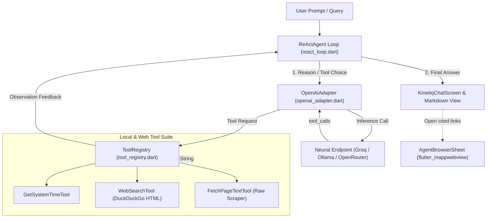

# ⚡ Kinetiq (`kinetiq_mobile`)

> **Mobile-first, next-generation autonomous AI agent application for Android, iOS, and Windows desktop.**  
> Designed to rival and outperform commercial clients (Groq, Perplexity, Muse) in execution speed, aesthetics, tool autonomy, and user privacy.

---

## 🌌 Project Vision & End Goal

Commercial mobile AI clients are typically locked into proprietary backend silos, cloud data logging, slow round-trips, and rigid personas. 

**Kinetiq** solves this with four core pillars:
1. **Zero-Central-Server BYOK (Bring Your Own Key) & LAN Edge Inference:** Connect directly to cloud LPUs (Groq, OpenRouter, OpenAI) or local LAN host machines running Ollama / vLLM (e.g. `http://10.0.2.2:11434/v1` or home servers over Wi-Fi).
2. **Local ReAct Autonomous Runtime:** An in-app streaming Reason-Act agent loop running directly in Dart using OpenAI-compatible function-calling JSON schemas. The agent decides when to think, when to call tools, and when to synthesize final results.
3. **Deep Web & Device Integration:** Real-time web scraping, DuckDuckGo search querying, and an **embedded autonomous browser** (`flutter_inappwebview`) with active site inspection.
4. **Obsidian / OLED Titanium Aesthetic:** A custom dark palette (`#07080D`, `#0F111A`) with dynamic cyber-vector Bitmoji personas (Muse, Titan, Cipher, Spark) featuring custom reactive canvas animations, orbiting energy rings, and collapsible execution badges.

---

## 🏗 System Architecture



---

## 🤖 Animated AI Personas

Each persona has custom prompt conditioning, reasoning style, and custom-painted cyber-vector avatars (`lib/widgets/agent_avatar.dart`):

| Persona | Archetype | Style & Color | Focus Areas |
| :--- | :--- | :--- | :--- |
| **Muse** | *Hyper-Creative* | Violet & Rose Glow (`#8B5CF6`) | Autonomous browsing, visual reasoning, creative workflows |
| **Titan** | *Deep Reasoning* | Cobalt & Cyan Glow (`#3B82F6`) | Software engineering, system architecture, deep code synthesis |
| **Cipher** | *Autonomous Scout* | Emerald & Neon Mint (`#10B981`) | Cyber recon, live web scraping, factual source verification |
| **Spark** | *High Velocity* | Amber & Flame Glow (`#F59E0B`) | Crisp briefings, instant bulleted productivity, quick action |

Avatars feature animated cyber-visors, reactive blinking optics, and rotating orbital energy beads that accelerate during agent reasoning and tool execution.

---

## 🔐 Security & Keystore Architecture

- **Hardware-Backed Encryption:** All API keys and sensitive endpoint tokens are stored on the device using `flutter_secure_storage` with Android `EncryptedSharedPreferences` (AES-256 GCM backed by Android Keystore).
- **Zero Cloud Leakage:** No API keys are committed to Git, logged to consoles, or routed through any intermediary proxy servers.
- **Cleartext LAN Support:** Android manifest is pre-configured with `usesCleartextTraffic="true"` and network state permissions (`INTERNET`, `ACCESS_NETWORK_STATE`, `ACCESS_WIFI_STATE`) to allow local HTTP inference against Ollama on LAN/Wi-Fi (`192.168.x.x` or emulator loopback `10.0.2.2`).

---

## 📁 Repository Directory Structure

```text
kinetiq_mobile/
├── android/                   # Android native wrapper & Gradle build scripts
│   ├── app/src/main/
│   │   └── AndroidManifest.xml # Internet, network state & cleartext permissions
│   └── settings.gradle.kts    # AGP 8.11.1 & Kotlin 2.2.20 configured
├── lib/
│   ├── main.dart              # Main entry point, theme & KinetiqChatScreen
│   ├── models/
│   │   ├── agent_character.dart # Persona definitions (Muse, Titan, Cipher, Spark)
│   │   └── endpoint_config.dart # Endpoint presets (Groq, Ollama LAN, OpenRouter)
│   ├── services/
│   │   ├── agent/
│   │   │   └── react_loop.dart  # Autonomous Reason-Act execution engine
│   │   ├── llm/
│   │   │   └── openai_adapter.dart # OpenAI-compatible Chat Completions client
│   │   ├── storage/
│   │   │   └── secure_key_store.dart # EncryptedSharedPreferences keystore
│   │   └── tools/
│   │       ├── base_tool.dart      # Abstract BaseTool specification
│   │       ├── mock_time_tool.dart # Local device timestamp tool
│   │       ├── tool_registry.dart  # Schema generator & tool dispatcher
│   │       └── web_tools.dart      # Web search & web page reader tools
│   └── widgets/
│       ├── agent_avatar.dart           # Custom-painted cyber-vector avatar
│       ├── agent_browser_sheet.dart    # Embedded in-app browser sheet
│       ├── character_selector_sheet.dart # Persona selection modal
│       └── network_endpoint_sheet.dart   # BYOK / Neural endpoint configuration modal
├── test/
│   └── widget_test.dart       # Smoke test suite
├── windows/                   # Windows desktop runner & CMake build config
└── pubspec.yaml               # Flutter package configuration & material fonts
```

---

## 🚀 Getting Started & Local Setup

### Prerequisites
- **Flutter SDK:** `>= 3.27.0` (Dart `>= 3.6.0`)
- **Android SDK:** Platform API 34-37
- **Java JDK:** JDK 21 (recommended: `openjdk-21`)
- **Visual Studio 2022** with C++ Workload (if building on Windows desktop)

### 1. Install Dependencies
```bash
flutter pub get
```

### 2. Run Verification
```bash
flutter analyze
flutter test
```

### 3. Run on Target Platform
- **Android Emulator / Device:**
  ```bash
  flutter run -d emulator-5554
  ```
- **Windows Desktop:**
  ```bash
  flutter run -d windows
  ```

---

## 🛠 Handover Guide for Future Developers & AI Agents

If you are a new AI engineer or developer taking over this project:

1. **Adding New Tools:**
   - Extend `BaseTool` in `lib/services/tools/base_tool.dart`.
   - Implement `name`, `description`, `parametersSchema`, and `execute(arguments)`.
   - Register the tool in `lib/main.dart` in `initState()` via `_registry.registerTool(...)`.
2. **Adding New Personas:**
   - Add new entries to `AgentCharacter.presets` in `lib/models/agent_character.dart`.
   - Add custom facial optics in `_BotFacePainter` inside `lib/widgets/agent_avatar.dart`.
3. **Connecting Local LLM Endpoints:**
   - Launch your local LLM (e.g., `ollama run llama3.2` or `vllm`).
   - From Android Emulator, connect using `http://10.0.2.2:11434/v1`.
   - From a physical mobile device on Wi-Fi, point to your host PC's LAN IP (`http://192.168.1.X:11434/v1`).
4. **Tool Calling Model Compatibility:**
   - When configuring custom models on Groq, ensure the model supports function calling (e.g. `openai/gpt-oss-120b`, `openai/gpt-oss-20b`, `qwen/qwen3.8-27b`).
