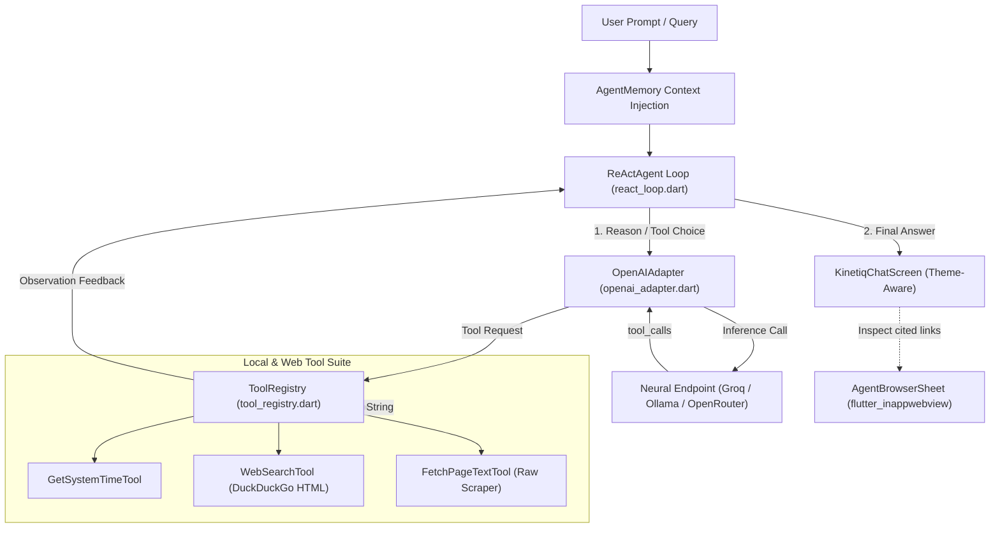

# ⚡ Kinetiq (`kinetiq_mobile`) — Antigravity Edition

> **Mobile-first, next-generation autonomous AI agent application for Android, iOS, and Windows desktop.**  
> Blending Google Antigravity simplicity and Apple UX elegance with edge inference speed, encrypted local memory, and autonomous web browsing.

---

## 🌌 Project Vision & End Goal

Commercial mobile AI clients are typically locked into proprietary backend silos, cloud data logging, slow round-trips, and rigid personas. 

**Kinetiq** solves this with five core pillars:
1. **Google Antigravity Simplicity & Apple UX Polish:** Clean, airy, zero-friction default aesthetic (`ThemeStyle.antigravityLight`) with soft elevated cards, modern typography, floating dock pills, and interactive kinetic graphics.
2. **Infinite Customization & Agent Soul:** Customize your agent's name (e.g. *Antigravity, Nova, Jarvis*), temperament, and custom backstory directives.
3. **Local Private Memory Bank:** Store encrypted user profile facts, preferences, and standing directives on-device. Memory context is injected directly into every ReAct execution loop.
4. **Grok Bot & Muse Teammate Model (A Computer of Its Own):** Bots operate as autonomous teammates that don't stall when you step away. They run multi-step workflows end-to-end on their own cloud VM browser runtime and pause for user approval on high-consequence operations (sending emails, making purchases).
5. **Agent Virtual PC & Python Execution Sandbox:** A true virtual computer environment inside the app (`PythonComputerTool`). The agent can execute Python scripts, compile ReportLab PDF documents (such as dynamically tailored 2-column resumes and markdown cover letters), read/write files to persistent virtual storage, and autonomously apply to jobs matching user qualifications.
6. **Zero-Central-Server BYOK & LAN Edge Inference:** Connect directly to cloud LPUs (Groq, OpenRouter, OpenAI) or local LAN host machines running Ollama / vLLM (`http://10.0.2.2:11434/v1` for Android Emulator or `http://192.168.x.x:11434/v1` over Wi-Fi).
7. **Local ReAct Autonomous Runtime & Embedded Browser:** In-app Reason-Act agent loop using OpenAI function calling to autonomously browse websites, search DuckDuckGo, extract web pages, and inspect pages live in `flutter_inappwebview`.

---

## 💻 Virtual Agent PC & Autonomous Job Application Pipeline

Kinetiq agents don't just chat or browse—**they have a computer of their own capable of running Python scripts and compiling documents in memory**:

* **Python & ReportLab Engine (`PythonComputerTool`):** Execute Python 3 scripts to generate formatted PDF documents, data transformations, and text artifacts.
* **Persistent In-Memory & Encrypted File System (`PcVirtualFile`):** Files generated by scripts (e.g., `generate_tailored_resume.py`, `PolicyMe_Resume.pdf`, `Cover_Letter.md`) are persisted directly into the agent's secure workspace.
* **Interactive Agent PC Terminal (`AgentPcTerminalSheet`):** Open the terminal from the AppBar (`Icons.terminal_rounded`) to view, edit, and execute Python code, manage workspace files, and inspect execution logs.
* **Autonomous Job Application Routine:**
  1. Agent inspects target job posting (e.g. *PolicyMe Senior Full Stack & AI Systems Engineer*).
  2. Compares requirements with the user's stored profile, degrees (e.g. UCalgary M.Eng.), and proficiencies (Python, React, LangGraph, AST validation, AWS).
  3. Executes Python ReportLab code to compile an ATS-optimized, 2-column PDF resume in PolicyMe's brand-aligned navy/teal palette.
  4. Generates a tailored cover letter and queues an approval card before submission.

---

## 👥 Grok Bot & Muse Autonomous Teammate Capabilities

Kinetiq incorporates the operational paradigms introduced by **Grok Bot** and **Muse**:

* **A Computer of Its Own (Isolated Runtime):** Bots run jobs on an isolated runtime environment (`AutonomousCloudVMTool`), so jobs do not stall when you switch apps or step away.
* **Message Like a Teammate:** Hand off complex tasks (e.g., *"Scrape competitor pricing, summarize key shifts, draft follow-up email"*) directly in chat or via the **Teammate Workspace**.
* **Safety Vault & User Approvals:** High-risk actions (purchases, outbound emails, account modifications) automatically pause for explicit human sign-off via interactive action cards before executing.
* **Multi-Bot Parallelism:** Assign specialized lanes to different teammates (e.g. Antigravity as Chief of Staff, Cipher for Cyber Recon, Titan for Code Fixes).
* **Workflows Saved as Routines:** Bots learn your preferences and edge cases, saving workflows as reusable routines that run faster next time without re-explaining.
* **Friendly Bitmoji Companion Aesthetics:** Lively animated Bitmoji companion graphics with expressive blinking eyes, blush cheeks, and floating antigravity halos replacing rigid geometric glyphs.

---

## 🏗 System Architecture



---

## 🎨 Theme & Visual Palette Engine

Kinetiq provides a multi-theme architecture controlled via `lib/models/app_theme_config.dart` and customizable in real-time inside the **Customization Studio**:

| Theme Mode | Style | Palette | Description |
| :--- | :--- | :--- | :--- |
| **Google Antigravity** *(Default)* | Clean Light | Paper White (`#F8FAFC`), Google Blue (`#1A73E8`) | Minimalist, airy, modern Google & Apple clean surfaces with soft shadows |
| **Antigravity Nebula** | Modern Dark Slate | Midnight Slate (`#0F172A`), Cyan/Indigo (`#6366F1`) | Gentle, soothing dark slate that is easy on the eyes (not pitch-black) |
| **Obsidian OLED** | Deep Black | Pure Black (`#050508`), Vivid Neon Glow | True zero-light black optimized for OLED displays and maximum contrast |
| **Cyber Titanium** | Metallic Zinc | Space Zinc (`#18181B`), Frosted Titanium | Apple space-gray and frosted metal aesthetics |

**Accent Color Palettes:** Google Blue, Quantum Violet, Emerald Mint, Amber Glow, Rose Quartz, Cyan Neon.

---

## 🤖 Animated Personas, Bitmoji Styles & Custom Avatars

Kinetiq features an expressive **Bitmoji Avatar Engine**. You can customize not just the persona and name, but independently choose the **visual Bitmoji face optics** for any model:

| Persona | Archetype | Default Bitmoji Style | Specialization |
| :--- | :--- | :--- | :--- |
| **Antigravity** *(Default)* | *Quantum Elegance* | Gentle curved quantum smile blinks | Graceful reasoning, thoughtful responses, clean Google simplicity |
| **Muse** | *Hyper-Creative* | Expressive anime-style cyber optics with catchlights | Autonomous browsing, visual reasoning, creative workflows |
| **Titan** | *Deep Reasoning* | Tactical wide cyber optics | Software engineering, systems architecture, deep code synthesis |
| **Cipher** | *Autonomous Scout* | Dual neon scanning rings | Cyber recon, live web scraping, factual source verification |
| **Spark** | *High Velocity* | Energetic angular lightning eyes | Crisp briefings, instant bulleted productivity, quick action |

*Users can select any Bitmoji facial expression style (Muse, Titan, Cipher, Spark, Antigravity) directly inside the Customization Studio (`customization_studio_sheet.dart`) and have it seamlessly applied to their active model.*
*The home screen and top navigation display a single, unified avatar image of your chosen model—eliminating redundant decorative icons.*

---

## 🧠 Memory Bank & Customer Data Context

Persistent, encrypted memory managed by `lib/models/agent_memory.dart` and `SecureKeyStore`:
- **User Identity:** Remembers the user's name and background bio/work role.
- **Fact Bank:** User-defined and agent-remembered facts categorized by *Preferences, Workstyle, Project, or General*.
- **Standing Directives:** Injected into every ReAct system prompt:
  ```text
  [PERSISTENT AGENT MEMORY & USER CONTEXT]
  - User Name: Alex
  - User Profile: Senior Software Architect
  - Standing Directives: Provide direct, elegant code. Prefer concise answers.
  - Remembered Facts:
    * [Preferences] Prefers Dart and Kotlin
    * [Workstyle] Values high execution velocity and verified sources
  [END OF MEMORY CONTEXT]
  ```

---

## 🔐 Security & Keystore Architecture

- **Hardware-Backed Encryption:** All API keys and sensitive endpoint tokens are stored on device using `flutter_secure_storage` with Android `EncryptedSharedPreferences` (AES-256 GCM backed by Android Keystore).
- **Zero Cloud Leakage:** No API keys are committed to Git, logged to consoles, or routed through any intermediary proxy servers.
- **Cleartext LAN Support:** Android manifest is pre-configured with `usesCleartextTraffic="true"` and network state permissions (`INTERNET`, `ACCESS_NETWORK_STATE`, `ACCESS_WIFI_STATE`) to allow local HTTP inference against Ollama on LAN/Wi-Fi (`192.168.x.x` or emulator loopback `10.0.2.2`).

---

## 📁 Repository Directory Structure

```text
kinetiq_mobile/
├── android/                   # Android native wrapper & Gradle build scripts
│   ├── app/src/main/
│   │   └── AndroidManifest.xml # Internet, network state & cleartext permissions
│   └── settings.gradle.kts    # AGP 8.11.1 & Kotlin 2.2.20 configured
├── lib/
│   ├── main.dart              # Main entry point, dynamic theme provider & chat screen
│   ├── models/
│   │   ├── agent_character.dart # Persona definitions & soul customization
│   │   ├── agent_memory.dart    # Encrypted memory bank & prompt context model
│   │   ├── app_theme_config.dart# Google Antigravity, Nebula & Obsidian theme engine
│   │   └── endpoint_config.dart # Endpoint presets (Groq, Ollama LAN, OpenRouter)
│   ├── services/
│   │   ├── agent/
│   │   │   └── react_loop.dart  # Autonomous Reason-Act execution engine
│   │   ├── llm/
│   │   │   └── openai_adapter.dart # OpenAI-compatible Chat Completions client
│   │   ├── storage/
│   │   │   └── secure_key_store.dart # EncryptedSharedPreferences keystore
│   │   └── tools/
│   │       ├── base_tool.dart      # Abstract BaseTool specification
│   │       ├── mock_time_tool.dart # Local device timestamp tool
│   │       ├── tool_registry.dart  # Schema generator & tool dispatcher
│   │       └── web_tools.dart      # Web search & web page reader tools
│   └── widgets/
│       ├── agent_avatar.dart           # Custom-painted cyber-vector avatar
│       ├── agent_browser_sheet.dart    # Embedded in-app browser sheet
│       ├── antigravity_logo.dart       # Kinetic orbital antigravity logo
│       ├── antigravity_startup_modal.dart # Animated welcome and tour sheet
│       ├── character_selector_sheet.dart # Persona selection modal
│       ├── customization_studio_sheet.dart # Unified 4-tab studio (Soul, Memory, Look, Keys)
│       └── network_endpoint_sheet.dart   # BYOK / Neural endpoint configuration modal
├── test/
│   ├── agent_memory_test.dart # Unit tests for memory bank & context injection
│   ├── theme_config_test.dart # Unit tests for theme system & Material 3 generation
│   └── widget_test.dart       # Smoke test suite
├── windows/                   # Windows desktop runner & CMake build config
└── pubspec.yaml               # Flutter package configuration & material fonts
```

---

## 🚀 Getting Started & Local Setup

### 1. Install Dependencies & Verify
```bash
flutter pub get
flutter analyze
flutter test
```

### 2. Run on Target Platform
- **Android Emulator / Device:**
  ```bash
  flutter run -d emulator-5554
  ```
- **Windows Desktop:**
  ```bash
  flutter run -d windows
  ```

---

## 📱 Connecting Phone to PC Local Models (Ollama / Qwen / Llama)

Kinetiq Mobile supports querying local LLMs hosted on your PC (such as **Qwen 2.5 Coder 14B**, **Qwen 2.5 Coder 7B**, or **Llama 3**) directly from your phone.

### Option A: USB Cable (Easiest, 0-Latency, No Firewall Friction)
1. Connect your Android phone to your PC via USB and enable **USB Debugging** in Developer Options.
2. In PowerShell or Command Prompt on your PC, run:
   ```powershell
   adb reverse tcp:11434 tcp:11434
   ```
3. In Kinetiq Mobile:
   - Go to **Customization Studio (Soul / Settings)** or tap the **Server/WiFi icon**.
   - Tap **Ollama (PC/Local)** preset (`http://localhost:11434/v1` or `http://127.0.0.1:11434/v1`).
   - Tap **"Fetch PC Models"** — Kinetiq queries Ollama, discovers all installed models (`qwen2.5-coder:14b`, `qwen2.5-coder:7b`, `llama3:latest`), and presents them as one-tap chips.
   - Tap your desired Qwen model to instantly activate it!

### Option B: Local Wi-Fi Network
1. Configure Ollama on Windows to listen on all interfaces:
   - Close Ollama from the Windows System Tray.
   - Set the environment variable:
     ```powershell
     [System.Environment]::SetEnvironmentVariable('OLLAMA_HOST', '0.0.0.0', 'User')
     ```
   - Restart Ollama: `ollama serve` (or launch Ollama from Start Menu).
2. Allow Ollama through Windows Firewall (port 11434 Inbound TCP).
3. Find your PC's Wi-Fi IP address via `ipconfig` (e.g. `192.168.1.150`).
4. In Kinetiq on your phone, set the Base URL to:
   ```text
   http://192.168.1.150:11434/v1
   ```
5. Tap **"Fetch Models"**, select `qwen2.5-coder:14b` or `qwen2.5-coder:7b`, and chat!

---

## ☁️ Accessing Ollama From ANYWHERE (AWS Deployment & Worldwide Tunnel)

Whether your models are running on an **AWS EC2 GPU instance** or on your **home PC while you're outside on cellular data**, Kinetiq connects to them securely from anywhere in the world.

### Method 1: Deploy Ollama on AWS EC2 (1-Click Automated Script)
We provide a production-ready script in `tools/deploy_ollama_aws.sh` to spin up Ollama on Ubuntu 22.04 / 24.04 (e.g. `g4dn.xlarge` or `g5.xlarge` for GPU acceleration):

1. Launch an EC2 Ubuntu instance and run:
   ```bash
   curl -O https://raw.githubusercontent.com/rkj1998/kinetiq_mobile/main/tools/deploy_ollama_aws.sh
   chmod +x deploy_ollama_aws.sh
   ./deploy_ollama_aws.sh
   ```
2. The script:
   - Installs and enables Ollama as a system service.
   - Downloads `qwen2.5-coder:7b` and `llama3:latest`.
   - Generates a cryptographically secure random Bearer API token.
   - Sets up NGINX reverse proxy with non-blocking LLM token streaming and token authentication.
   - Prints your **Base URL** (e.g. `http://<EC2-PUBLIC-IP>:11434/v1`) and **API Key**.
3. In Kinetiq Mobile on your phone:
   - Select the **"Ollama Cloud / AWS (Anywhere)"** preset.
   - Paste the Base URL and generated API Key.
   - Tap **"Fetch Models"** — all AWS models appear instantly on your phone!

### Method 2: Access your Home PC Ollama from Anywhere (Free Cloudflare Tunnel)
You don't need a static IP or router port forwarding to access your PC's Qwen models when you are away from home:

1. Run the included Python tunnel script on your PC:
   ```powershell
   python tools/tunnel_pc_ollama.py --tunnel cloudflare
   ```
2. It generates a secure, free HTTPS URL (e.g., `https://random-subdomain.trycloudflare.com`).
3. In Kinetiq Mobile on your phone (on 5G / cellular / coffee shop Wi-Fi):
   - Set Base URL: `https://<subdomain>.trycloudflare.com/v1`
   - Tap **"Fetch Models"**.
   - Your PC's `qwen2.5-coder:14b` and `qwen2.5-coder:7b` load immediately!

---

### Installing Kinetiq on Your Phone
- **Direct Run via USB:**
  ```bash
  flutter run -d <your-phone-device-id>
  ```
- **Build APK to install manually:**
  ```bash
  flutter build apk --debug
  # APK output: build/app/outputs/flutter-apk/app-debug.apk
  ```


